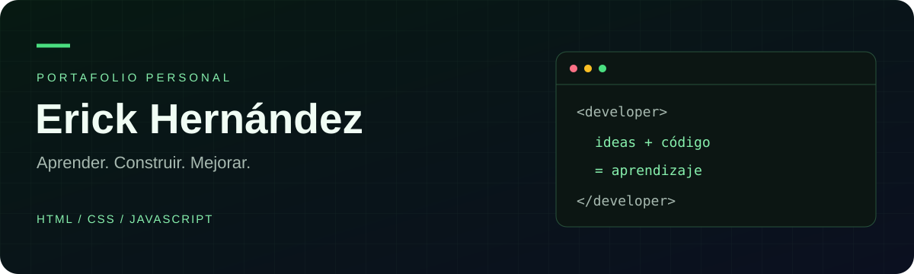

<div align="center">



### Mis primeros pasos en desarrollo web, en un solo lugar.

Un proyecto para experimentar con interfaces, animaciones e interacciones mientras avanzo en mi formación en desarrollo de software.

[](https://developer.mozilla.org/es/docs/Web/HTML)
[](https://developer.mozilla.org/es/docs/Web/CSS)
[](https://developer.mozilla.org/es/docs/Web/JavaScript)
[](https://getbootstrap.com/)

**Proyecto en desarrollo · Sitio estático · Sin proceso de compilación**

[Explorar el código](index.html) · [Mi perfil de GitHub](https://github.com/ErickFrancis-22)

</div>

---

## Sobre el proyecto

Este portafolio nace como una práctica de desarrollo frontend durante mi formación en **Desarrollo de Software en ITCA-FEPADE**. Combina una presentación personal con una interfaz oscura, acentos verdes y efectos visuales.

Forma parte de mi recorrido de aprendizaje. Actualmente también profundizo en **C#, ASP.NET Core y SQL Server**, con interés en el desarrollo backend.

## Qué incluye

- **Presentación personal** con una sección principal y una ventana de código animada.
- **Diseño adaptable** construido con la grilla y los componentes de Bootstrap 5.
- **Efectos visuales** con JavaScript y bibliotecas de animación.
- **Cambio entre español e inglés** para el contenido principal mediante i18next.
- **Sección de habilidades** con indicadores animados.

## Tecnologías y recursos

| Herramienta | Uso en el sitio |
| :--- | :--- |
| HTML y CSS | Estructura, estilos y diseño visual |
| JavaScript | Interacciones y efectos |
| Bootstrap 5 y Bootstrap Icons | Componentes, grilla e iconos |
| i18next | Traducción del contenido principal |
| GSAP, ScrollTrigger, AOS y ScrollReveal | Recursos de animación |
| Particles.js | Fondo de partículas |

## Ejecutarlo localmente

```bash
git clone https://github.com/ErickFrancis-22/mi-pagina-web.git
cd mi-pagina-web
```

Abrí `index.html` en tu navegador o usá **Live Server** desde Visual Studio Code.

No requiere instalar paquetes ni compilar. Las bibliotecas, los iconos y algunas fuentes se cargan desde servicios externos, por lo que se necesita conexión a internet para visualizar todos los recursos.

## Estructura

```text
mi-pagina-web/
├── assets/
│   └── readme-banner.svg  # Encabezado del README
├── index.html            # Página principal
├── competencias.html     # Archivo reservado para competencias
├── styles.css            # Estilos del sitio
├── effects.js            # Animaciones e interacciones
└── languajes.js          # Traducciones y cambio de idioma
```

## Próximas mejoras

- [ ] Completar las secciones de proyectos y competencias.
- [ ] Reemplazar los textos y enlaces de ejemplo.
- [ ] Incorporar las imágenes pendientes de la galería.
- [ ] Actualizar la presentación y revisar la accesibilidad.

---

<div align="center">

**Erick Francis Hernández Angel**  
Formación en Desarrollo de Software · ITCA-FEPADE

[GitHub](https://github.com/ErickFrancis-22) · [Contacto](mailto:erickfrancishernandez@gmail.com)

</div>
